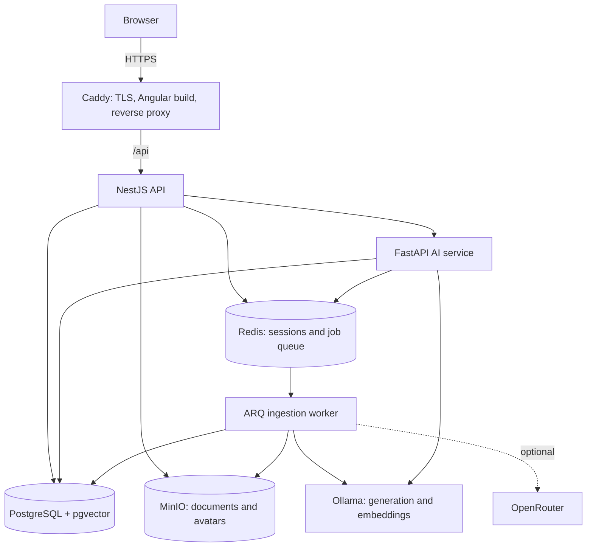
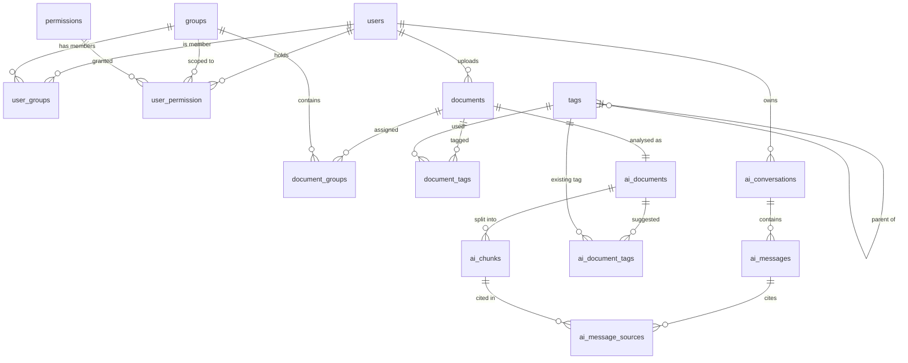

*This project has been created as part of the 42 curriculum by ghambrec, nluchini, poverbec, cbauer.*

# Archie — AI-Assisted Document Management

## Description

Archie is a self-hosted document management platform, built as our **ft_transcendence** project. It is made for households and small clubs who want to keep invoices, contracts, insurance policies and similar papers in one place, find them again quickly, and ask questions about their content.

Users upload documents into groups. Every upload is analysed in the background: the text is extracted (including OCR for scans and photos), summarised, tagged and indexed. Afterwards the documents can be found through a filtered full-text search or queried in a chat that answers only from documents the user is allowed to read and names its sources.

### Key features

- **Accounts and sessions:** sign-up and login with server-side sessions in Redis, forced password change on first login, login attempt lockout, profile with avatar and language.
- **Groups as organizations:** administrators create groups, add and remove members, and grant permissions per user and group.
- **Permissions:** `documents.read`, `documents.upload`, `documents.update` and `documents.delete` are checked per group on every document route and in the AI retrieval. Administration views are only available to admins.
- **Document management:** validated upload (file type, real content type, size limit), listing, preview, download, rename, move to another group, delete.
- **AI analysis:** text extraction from PDF, images (OCR in German, English and Spanish), DOCX, ODT, XLSX, XLS, CSV, Markdown and plain text; language detection, summary and tag suggestions with confidence values.
- **Review:** AI tag suggestions are confirmed or corrected by the user, failed analyses can be restarted.
- **Tags:** hierarchical tags in two facets (`domain`, `doctype`), maintained by admins.
- **Advanced search:** search terms over filename, tags, summary, uploader, group and extracted text with relevance ranking and highlighted snippets; filters for group, tag, file type and date range; sorting and pagination.
- **Document chat (RAG):** conversations with history, answers with confidence score and source documents, restricted to readable documents.
- **Internationalization:** English, German and Spanish user interface.
- **Monitoring:** Prometheus metrics for both backends and all containers, Grafana dashboards.
- **Deployment:** one command, HTTPS through Caddy, internal services not reachable from outside.

## Instructions

### Prerequisites

- Docker Engine with Docker Compose v2.24 or newer.
- GNU Make.
- Internet access for the first start (image builds, dependency installation, model downloads).
- Free port 443.
- Enough RAM and disk space for the configured Ollama models.

### Configure

From the repository root, create the local configuration:

```sh
cp -n env/.env.example env/.env
```

Edit `env/.env` before the first start:

- Set the database credentials, the seeded administrator account (`ADMIN_USER`, `ADMIN_USER_PASSWORD`), the MinIO credentials, the Grafana admin password and a strong `AI_SERVICE_API_KEY`.
- `LLM_PROVIDER=ollama` keeps generation local. `openrouter` requires a valid `OPENROUTER_API_KEY` and sends analysis content to the external provider. Embeddings always use Ollama.
- Leave `LANGFUSE_ENABLED=false` unless a separately configured Langfuse instance is available.

### Start

```sh
make
```

`make` (same as `make up`) builds the images and starts the production stack including monitoring: the Angular build is served by Caddy, NestJS runs the compiled application, and the AI service runs without reload. The NestJS container runs the database migrations before it starts, the AI container creates its own tables. The first start takes longer because the Ollama initializer downloads the configured models.

Open https://localhost afterwards. Caddy issues the certificate from its own local authority, so the browser shows a certificate warning that has to be accepted once. Log in with the administrator account from `env/.env`; the application asks for a new password on the first login.

For development use the dev stack instead:

```sh
make dev
```

It adds `docker-compose.dev.yml` on top: source directories are mounted, NestJS, the AI service, the worker and the Angular dev server restart on file changes, and some ports are published on `127.0.0.1`. The entry point stays https://localhost. Run `make down` before switching between the two stacks.

### Endpoints

| Service | Address | Stack |
| --- | --- | --- |
| Application | https://localhost | prod and dev |
| NestJS API | https://localhost/api | prod and dev |
| Swagger documentation | https://localhost/api/docs | prod and dev |
| Grafana | https://localhost/grafana | prod and dev |
| Prometheus | http://127.0.0.1:9090 | prod and dev |
| NestJS API, direct | http://127.0.0.1:3000 | dev only |
| MinIO console | http://127.0.0.1:9001 | dev only |
| Adminer | http://127.0.0.1:8080 | dev only |
| PostgreSQL | `127.0.0.1:5432` | dev only |

Only port 443 is published to the network. Ports bound to `127.0.0.1` are reachable from the local machine only. Redis, the MinIO API, the AI service and Ollama do not publish a host port in either stack.

### Useful commands

```sh
# Stop prod or dev stack, volumes are kept
make down

# Remove containers and images / also remove all volumes (deletes stored data)
make clean
make fclean

# Follow the logs
docker compose logs -f nest-server ai-service ai-service-worker

# Backend unit tests
docker compose exec nest-server pnpm test --runInBand

# Backend end-to-end tests with separate test infrastructure
make test
```

`make test` uses `docker-compose.test.yml` and `env/.env.test` and does not touch the data of the running stack.

## Team Information

| Member | Role | Responsibilities |
| --- | --- | --- |
| ghambrec | Product Owner, Technical Lead, Developer | Document frontend (list, upload, preview, review, search, tags), AI ingestion pipeline, Docker and HTTPS infrastructure |
| nluchini | Technical Lead, Developer | NestJS foundation, authentication and sessions, documents and storage backend, tags, permissions, CI and end-to-end tests |
| poverbec | Project Manager, Developer | User management backend and frontend, profile, RAG retrieval and conversations, chat frontend, monitoring |
| cbauer | Developer | Groups and memberships backend and frontend, profile and login views |

## Project Management

The team met regularly to plan, review progress and split the work by topic. Tasks were planned and tracked in Notion.

- **Communication:** WhatsApp group for quick questions and coordination, Notion for tasks, notes and decisions.
- **Version control:** GitHub with one feature branch per topic, merged into `main` through pull requests.
- **Continuous integration:** GitHub Actions build the frontend and the backend on every pull request and run the backend end-to-end tests against PostgreSQL, Redis and MinIO service containers.

## Technical Stack

| Layer | Technology | Why |
| --- | --- | --- |
| Frontend | Angular 22, TypeScript, Bootstrap, Transloco | Complete framework with routing, forms and HTTP client included; strict typing shared with the backend language |
| Backend | NestJS 11, TypeORM | Modular structure with guards and validation pipes fits a permission-heavy API; migrations keep the schema reproducible |
| AI service | Python 3.14, FastAPI, ARQ, Pydantic AI | The Python ecosystem offers the libraries for parsing, OCR and LLM access; long-running analyses run in a queue worker instead of a request |
| Database | PostgreSQL 18 with pgvector and pg_trgm | One database for relational data, embeddings and trigram search, so permissions can be joined directly into vector and text queries |
| Object storage | MinIO (S3-compatible) | Keeps file bytes out of the database and is self-hostable |
| Sessions and queue | Redis | Server-side sessions that can be revoked, and the job queue for the worker |
| Models | Ollama, optional OpenRouter | Documents stay on the own machine by default; an external provider can be enabled on purpose |
| Reverse proxy | Caddy | HTTPS with automatic certificates, serves the Angular build, forwards `/api` and `/grafana` |
| Monitoring | Prometheus, Grafana, cAdvisor, node-exporter | Metrics of the applications, the containers and the host in one place |
| Orchestration | Docker Compose, Make | The whole stack starts with one command |

### Architecture



Caddy is the only entry point. The browser talks HTTPS to Caddy; connections behind it are plain HTTP inside Docker networks. The stack uses three networks: `edge` (Caddy, NestJS, Grafana), `backend` (NestJS, AI service, worker, PostgreSQL, Redis, MinIO, Ollama) and `monitoring` (Prometheus, Grafana, exporters and the two metric targets). Caddy therefore cannot reach the database or the AI service. The AI service is called by NestJS only and expects an API key.

Frontend and API share one origin, so CORS is not enabled. The session cookie is `HttpOnly`, `Secure` and `SameSite=Lax`. Passwords are stored as bcrypt hashes.

### Document processing

1. An authenticated user with the upload permission sends a file to NestJS. The file type is checked against an allow list by extension and by detected content, the size against `DOCUMENT_MAX_UPLOAD_SIZE_MB`.
2. NestJS stores the bytes in MinIO and the metadata (uploader, object key, filename, MIME type, size, SHA-256) in PostgreSQL, then calls the AI service.
3. The AI service creates the analysis record and queues a job. The worker loads the file, extracts the text, detects the language and requests a summary and tags from the model.
4. The text is split into overlapping chunks. Ollama creates 1,024-dimensional embeddings, which are stored with the chunks and indexed with HNSW.
5. The status is tracked as `PENDING`, `PROCESSING`, `FINISHED`, `FAILED` or `SKIPPED` and shown in the document list.

For a chat question, the AI service embeds the question, searches the chunks of documents for which the user holds `documents.read` in the document's group, builds the context within a fixed budget and lets the model answer with a confidence score. The answer is stored with its source chunks.

## Database Schema

NestJS owns the application tables through TypeORM migrations. The AI service creates the `ai_*` tables with its own SQL. Sessions and the job queue live in Redis and are not part of the schema.



| Table | Key fields | Purpose |
| --- | --- | --- |
| `users` | `id` uuid, `email` varchar unique, `password_hash` varchar, `display_name` varchar, `avatar_object_key` varchar, `preferred_language` varchar, `is_active` boolean, `must_change_password` boolean, `last_login_at`, `deleted_at` timestamptz | Accounts; deletion is a soft delete and can be reverted |
| `groups` | `id` uuid, `name` varchar unique, `description` varchar, `is_system` boolean | Organizations (household, club); the system group `admin` holds the administrators |
| `user_groups` | `user_id`, `group_id` uuid (composite key), `invited_by` uuid, `joined_at` timestamptz | Group membership |
| `permissions` | `id` uuid, `perm_key` varchar unique, `description` varchar | Available permission keys |
| `user_permission` | `id` uuid, `user_id`, `group_id`, `permission_id` uuid (unique together) | Permission of one user inside one group |
| `documents` | `id` uuid, `uploaded_by` uuid, `filename`, `mime_type`, `object_key` varchar, `size_bytes` bigint, `sha256` varchar, `page_count` integer, `reviewed_ai_at`, `deleted_at` timestamptz | File metadata; the bytes are in MinIO |
| `document_groups` | `document_id`, `group_id` uuid (composite key) | Group a document belongs to |
| `tags` | `id` uuid, `name` varchar(100) unique, `label` varchar(150), `facet` varchar(16), `parent_id` uuid, `is_system` boolean | Hierarchical tags |
| `document_tags` | `document_id`, `tag_id` uuid (composite key), `assigned_by` uuid | Confirmed tags of a document |
| `ai_documents` | `id` uuid (= `documents.id`), `status` varchar(20), `ai_summary` text, `language` varchar(10), `error_key`, `error_detail` text, `retry_count` smallint | Analysis state and result |
| `ai_chunks` | `id` uuid, `ai_document_id` uuid, `chunk_index` integer, `content` text, `embedding` vector(1024), `page_number` integer | Text chunks with embeddings (HNSW cosine index, trigram index on `content`) |
| `ai_document_tags` | `id` uuid, `ai_document_id` uuid, `ai_tag_id` uuid or `proposed_name` varchar(100), `confidence` real | Tag suggestions, either an existing tag or a proposal for a new one |
| `ai_conversations` | `id` uuid, `user_id` uuid, `title` varchar(255) | Chat conversations |
| `ai_messages` | `id` uuid, `conv_id` uuid, `sender` varchar(10), `content` text | Questions and answers |
| `ai_message_sources` | `message_id`, `chunk_id` uuid (composite key), `similiary_score` real | Chunks an answer is based on |

## Features List

| Feature | Description | Members |
| --- | --- | --- |
| Authentication and sessions | Login, logout, session check, Redis sessions, lockout after failed attempts, forced password change | nluchini, cbauer, poverbec, ghambrec |
| User administration | Create, edit, soft delete and restore users, reset passwords | poverbec, nluchini, ghambrec |
| Profile | Display name, language, avatar upload, password change, own groups | poverbec, cbauer |
| Groups and memberships | Create, edit and delete groups, add and remove members | cbauer, ghambrec |
| Permissions | Per-user, per-group permissions, guards on the API, permission editor | nluchini, ghambrec, cbauer |
| Document storage | Upload with validation, MinIO storage, download, preview, rename, move, delete | nluchini, ghambrec |
| Document views | List with status, upload dialog with progress, preview, detail view | ghambrec |
| Tags | Tag tree, tag administration, tagging of documents | nluchini, ghambrec |
| AI ingestion | Queue worker, text extraction and OCR, language detection, summary, tag suggestions, chunking, embeddings | ghambrec, poverbec |
| Review | Confirm or correct AI tag suggestions, restart failed analyses | ghambrec |
| Advanced search | Ranked full-text search with snippets, filters, sorting, pagination, trigram indexes | ghambrec |
| Document chat | Permission-aware retrieval, generation with sources and confidence, conversation history | poverbec, ghambrec |
| Chat interface | Conversation list, messages, sources, rename and delete | poverbec |
| Internationalization | English, German and Spanish translations, language stored per user | ghambrec, poverbec |
| Monitoring | Metrics endpoints, Prometheus, Grafana dashboards, cAdvisor, node-exporter | poverbec |
| CI and tests | GitHub Actions, end-to-end test stack | nluchini |
| Deployment | Docker Compose, Caddy with HTTPS, network separation, prod and dev stack | ghambrec |

## Modules

| Module | Type | Points | Implementation | Members |
| --- | --- | ---: | --- | --- |
| Framework for frontend and backend | Major | 2 | Angular for the frontend, NestJS for the backend | all |
| Standard user management and authentication | Major | 2 | Accounts, sessions, profile page, avatar upload, password handling | nluchini, poverbec, cbauer |
| Advanced permissions system | Major | 2 | Permission keys per user and group, guards on every document route, admin-only views, user administration | nluchini, ghambrec, cbauer |
| Organization system | Major | 2 | Groups with members; documents, permissions and search are scoped to groups | cbauer, ghambrec |
| RAG system | Major | 2 | Chunking, embeddings in pgvector, retrieval limited to readable documents, answers with sources | poverbec, ghambrec |
| LLM system interface | Major | 2 | Structured summaries and tag suggestions during ingestion, chat generation, local or external provider | ghambrec, poverbec |
| Monitoring with Prometheus and Grafana | Major | 2 | Custom metrics in NestJS and the AI service, exporters, provisioned dashboards, Grafana behind HTTPS | poverbec |
| ORM | Minor | 1 | TypeORM entities and migrations | nluchini |
| File upload and management | Minor | 1 | Type and size validation, storage in MinIO, preview, progress, delete | nluchini, ghambrec |
| Advanced search | Minor | 1 | Filters, sorting, pagination, ranking and highlighting | ghambrec |
| Multiple languages | Minor | 1 | English, German, Spanish with Transloco | ghambrec, poverbec |
| **Total** | | **18** | | |

We chose these modules because they describe what a document archive for several people needs: accounts, groups with separated access, reliable file handling and a way to find things again. The AI modules are the core idea of the project; the monitoring module came from the need to see how long ingestion and chat requests take on local models.

## Individual Contributions

- **ghambrec:** document frontend (list, upload, preview, detail, review, search, tags), search backend, AI ingestion pipeline (worker, extraction, analysis, chunking, embeddings), review endpoints, Docker setup with Caddy, HTTPS and network separation.
- **nluchini:** NestJS project setup, authentication and session handling, documents module with validation and MinIO storage, tags and permissions backend, TypeORM migrations, GitHub Actions and the end-to-end test environment.
- **poverbec:** user management backend and frontend, profile page, retrieval and conversation logic in the AI service, chat interface, Prometheus and Grafana monitoring.
- **cbauer:** groups and group membership in backend and frontend, permission editor, login and profile views.

## Resources

- [NestJS documentation](https://docs.nestjs.com/)
- [Angular documentation](https://angular.dev/)
- [TypeORM documentation](https://typeorm.io/)
- [FastAPI documentation](https://fastapi.tiangolo.com/)
- [Pydantic AI documentation](https://ai.pydantic.dev/)
- [pgvector](https://github.com/pgvector/pgvector)
- [Ollama documentation](https://docs.ollama.com/)
- [Caddy documentation](https://caddyserver.com/docs/)
- [Prometheus documentation](https://prometheus.io/docs/) and [Grafana documentation](https://grafana.com/docs/)
- [Docker Compose documentation](https://docs.docker.com/compose/)

### Use of AI

AI assistants (Claude, GitHub Copilot) were used to explain concepts and libraries, to review code and discuss alternatives, to find the cause of errors, to draft configuration (Docker Compose, Caddy), and to write and polish documentation such as this README, code comments and API descriptions. The results were read, tested and adapted by the team; every member can explain the code they are responsible for. Inside the product, language models are used for summaries, tag suggestions and chat answers as described above.

## Repository layout

```text
frontend/                 Angular application, translations, and Caddy configuration
backend/nest-server/      NestJS API, TypeORM migrations, and backend tests
backend/ai-service/       FastAPI API, ARQ worker, analysis, and vector indexing
backend/postgres-init/    PostgreSQL extension initialization
monitoring/               Prometheus configuration and Grafana dashboards
env/                      Environment templates and test configuration
docker-compose.yml        Production stack
docker-compose.dev.yml    Development override (hot reload, local ports)
docker-compose.test.yml   Backend end-to-end test infrastructure
Makefile                  Start, cleanup, and test commands
```
